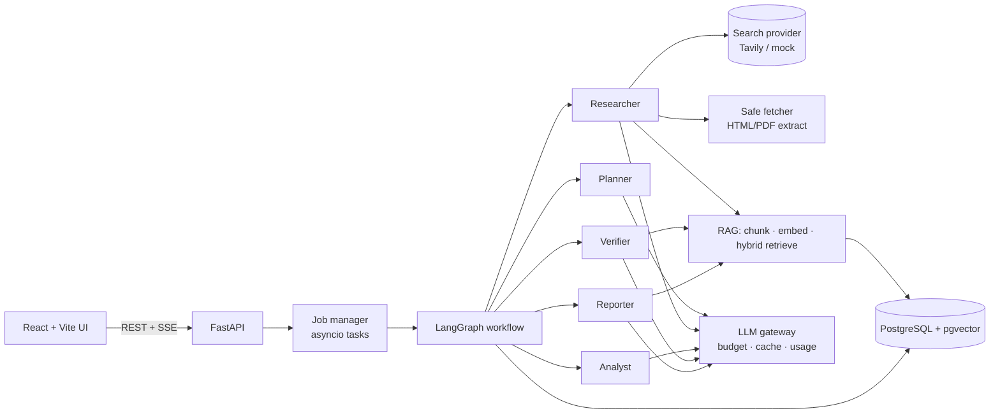
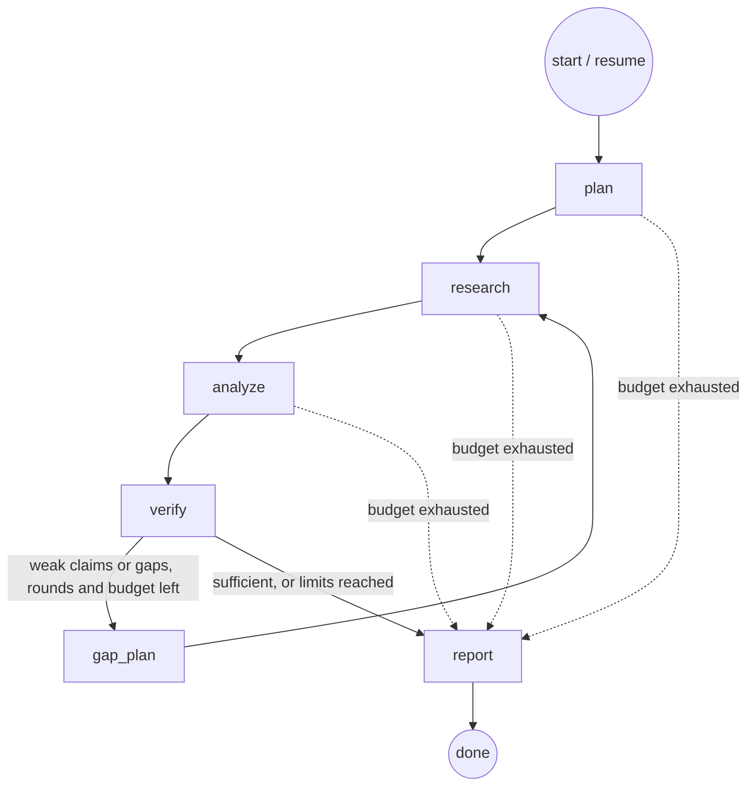

# SCOUT AI — Autonomous Multi-Agent Research Platform

SCOUT AI takes a complex research question, plans an investigation, searches the web, reads the actual
source pages and PDFs, extracts evidence with verbatim quotes, **verifies important claims against that
evidence**, runs more research when evidence is insufficient, and writes a cited report you can question further.

It is built to be inspected: every finding links to a quote that was checked to exist in the source, every
verification status comes from deterministic rules over judged evidence (not model confidence), and every
citation in the report resolves to a page the system actually retrieved.

## Features

- **Planning agent**: decomposes a question into prioritised, de-duplicated research tasks (structured Pydantic outputs).
- **Research agent**: provider-independent web search (Tavily), SSRF-safe fetching, HTML (trafilatura) and PDF (pypdf) extraction, chunking, embedding, hybrid retrieval, and quote-grounded finding extraction.
- **Analysis agent**: themes, atomic claims traceable to findings, preserved disagreements between sources, evidence gaps.
- **Verification agent**: retrieves evidence per claim, judges each passage, **checks every quote verbatim and every number in code**, and assigns *Supported / Partially supported / Conflicting / Unsupported / Unable to verify*.
- **Controlled research loop** (LangGraph): weak claims and gaps trigger additional targeted research, bounded by rounds, tool calls, tokens, cost and wall-clock time.
- **Report agent**: 11-section professional report; methodology, evidence, limitations and references are generated from data, not by the model; invalid citations are stripped automatically.
- **Follow-ups, "investigate further", per-section regeneration, report versions, Markdown/HTML/JSON/PDF export.**
- **Standalone RAG**: upload PDFs/text to a library, query them with grounded, cited answers, or attach them to research.
- **Live UI**: React dashboard with real-time progress over Server-Sent Events (plan, searches, sources, findings, verdicts).
- **Reliability**: persisted state, resume after failure/cancel/restart, cancellation, retries, LLM response cache (resumes never pay twice), rate limiting, prompt-injection defences.
- **Evaluation framework**: retrieval (P@k, R@k, MRR, nDCG), answer (fact recall, faithfulness, relevance), citation (URL validity, support rate), agent and system metrics, with direct-LLM / single-pass-RAG / agent baselines.

## Architecture





Details: [docs/ARCHITECTURE.md](docs/ARCHITECTURE.md), [docs/AGENT_WORKFLOW.md](docs/AGENT_WORKFLOW.md), [docs/RAG_PIPELINE.md](docs/RAG_PIPELINE.md).

## Technology stack

| Layer | Choice |
|---|---|
| Backend | Python 3.12, FastAPI, Pydantic v2, SQLAlchemy 2 (async, psycopg 3), Alembic |
| Agents | LangGraph (explicit state graph); OpenAI SDK for structured outputs (no LangChain needed) |
| Data | PostgreSQL 17 + pgvector (HNSW cosine) + Postgres full-text search |
| Retrieval | Tavily search, httpx, trafilatura, pypdf, tiktoken |
| Frontend | React 19, TypeScript, Vite 8, Tailwind CSS 4, react-markdown |
| Infra | Docker, Docker Compose, nginx, structlog, pytest |

## Prerequisites

- Docker + Docker Compose
- For local development: [uv](https://docs.astral.sh/uv/) (Python 3.12 is installed by uv) and Node ≥ 20.19 / 22.12 (`.nvmrc` pins 22)
- For real research: an **OpenAI API key** and a **Tavily API key**

## Quick start (Docker)

```bash
cp .env.example .env          # add OPENAI_API_KEY and TAVILY_API_KEY
docker compose up -d --build
open http://localhost:8080    # UI;  API docs: http://localhost:8010/docs
```

No keys yet? Set `LLM_PROVIDER=mock EMBEDDING_PROVIDER=mock SEARCH_PROVIDER=mock` in `.env` to run an
**offline demo** over a bundled, clearly-labelled *fictional* corpus ("Freedonia"). Mock mode is never
enabled implicitly; the UI shows a banner and every mock report says so.

## Environment configuration

All settings come from environment variables (see [.env.example](.env.example)). Key ones:

| Variable | Purpose |
|---|---|
| `LLM_PROVIDER`, `EMBEDDING_PROVIDER`, `SEARCH_PROVIDER` | `openai` / `tavily` for real use, `mock` for offline |
| `OPENAI_API_KEY`, `TAVILY_API_KEY` | Secrets (the app refuses to start if a configured real provider has no key) |
| `OPENAI_MODEL`, `OPENAI_REPORT_MODEL` | Agent model (default `gpt-5.4-mini`) and optional stronger report model |
| `EMBEDDING_MODEL`, `EMBEDDING_DIM` | Default `text-embedding-3-small` / 1536 (must match the migration) |
| `PRICE_*_PER_MTOK` | Prices used for **cost estimates**; set them to your actual prices |
| `RETRIEVAL_MODE` | `hybrid` (default), `vector` or `keyword` |
| `DATABASE_URL` | Defaults to the compose Postgres on `localhost:5433` |

## Local development

```bash
docker compose up -d db                      # Postgres + pgvector on :5433 (also creates scout_test)

cd backend
uv sync                                      # installs Python 3.12 deps
uv run alembic upgrade head                  # database setup / migrations
uv run uvicorn app.main:app --port 8010 --reload

cd ../frontend
nvm use && npm install
npm run dev                                  # http://localhost:5173 (proxies /api to :8010)
```

## Tests

```bash
cd backend
uv run pytest                 # unit + integration (needs `docker compose up -d db`); no paid API calls
uv run pytest tests/unit      # no database needed
RUN_LIVE=1 TEST_LLM_PROVIDER=openai TEST_EMBEDDING_PROVIDER=openai TEST_SEARCH_PROVIDER=tavily \
  uv run pytest tests/live -s # optional paid smoke test
```

Tests force mock providers, use a separate `scout_test` database, and cover API endpoints, schemas, planner,
search providers, extraction, chunking, embedding/ingestion, vector/keyword/hybrid retrieval, state routing,
verification rules, report generation, failure handling, budgets, cancellation and resume.

## Evaluation

```bash
cd backend
uv run python -m app.evaluation.run retrieval --dataset ../evaluation/datasets/retrieval_fixture.json
uv run python -m app.evaluation.run e2e --dataset ../evaluation/datasets/freedonia_mock.json --depth standard
# with real keys configured:
uv run python -m app.evaluation.run e2e --dataset ../evaluation/datasets/real_world.json --depth quick
```

Results go to `evaluation/results/`. See [docs/EVALUATION.md](docs/EVALUATION.md) for metric definitions and the
results actually measured so far (mock mode only; no live run has been performed yet).

## Example research requests

- *Analyse the Indian electric vehicle market. Identify major competitors, market size, growth trends, government policies, challenges, investment opportunities, and future outlook.*
- *What is the state of solid-state battery commercialisation? Who leads, what are the technical barriers, and which timelines are credible?*
- *Compare the EU, US and Chinese regulatory approaches to generative AI and their implications for startups.*

## Known limitations

- **No live (OpenAI + Tavily) run has been executed in this repository yet**; all measured results are from mock mode. Mock results measure pipeline mechanics, not model quality.
- Verification establishes that retrieved sources *state* a claim; it cannot establish that the sources are right. Source reliability is not scored (only domain diversity).
- Jobs run in the API process (bounded concurrency). Multiple API replicas would need a shared queue and a shared rate limiter (see ARCHITECTURE.md).
- No authentication or multi-tenancy: designed as a single-user/self-hosted tool.
- Scanned PDFs are not OCR'd; JavaScript-rendered pages may extract poorly; paywalled pages are skipped.
- SSRF protection validates DNS before each request and redirect; a DNS-rebinding window remains (SECURITY.md).

## Documentation

[Architecture](docs/ARCHITECTURE.md) · [Agent workflow](docs/AGENT_WORKFLOW.md) · [RAG pipeline](docs/RAG_PIPELINE.md) ·
[API](docs/API_DOCUMENTATION.md) · [Evaluation](docs/EVALUATION.md) · [Security](docs/SECURITY.md) ·
[Development guide](docs/DEVELOPMENT_GUIDE.md) · [Status](DEVELOPMENT_STATUS.md)
