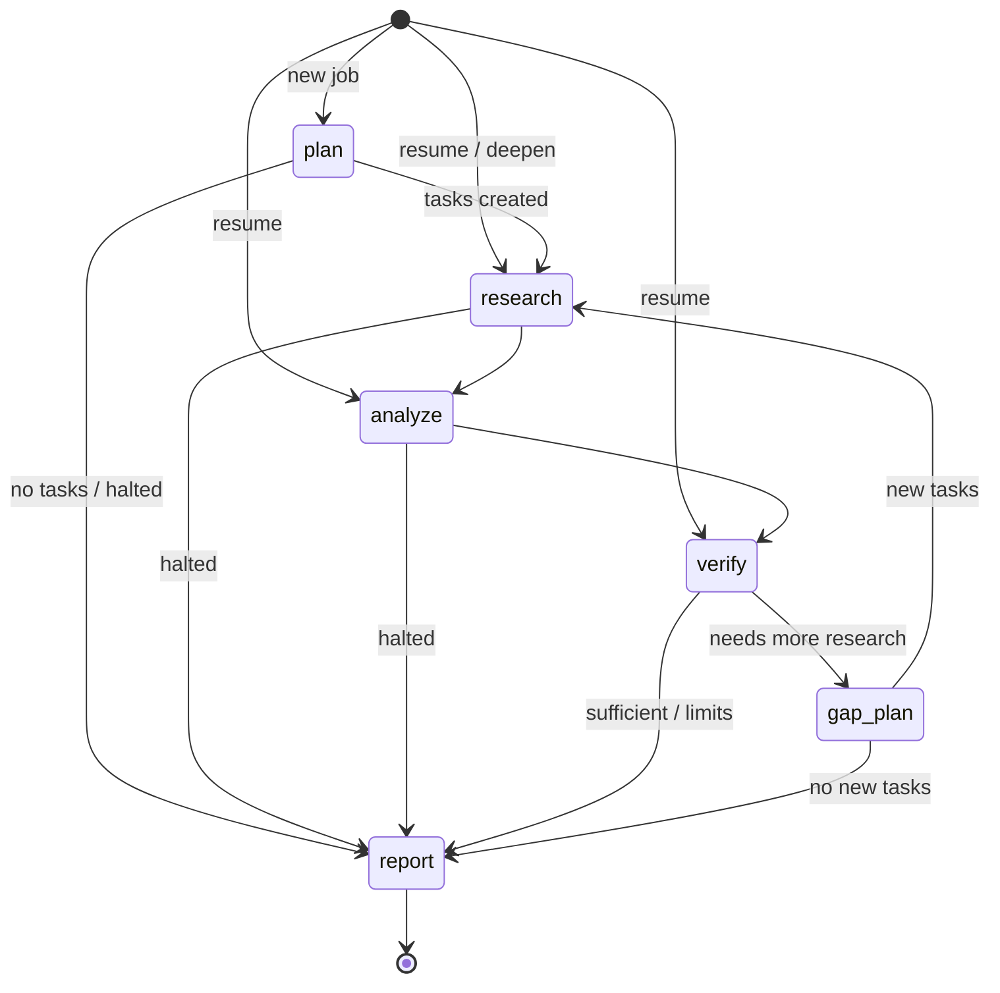

# Agent Workflow

## State machine

Implemented in `backend/app/orchestration/graph.py`. Every node runs through `_run_node`, which:

1. Skips non-report nodes when a halt reason is set.
2. Persists `job.stage` (used for resume) and emits a `stage` event.
3. Checks cancellation (`cancel_requested` in the DB), then budgets (`UsageTracker.check()`).
4. Runs the agent. A `BudgetExceeded` from anywhere inside becomes `halt_reason` and routes to `report`.
5. Persists the usage snapshot.

**Graph state** (`ResearchState`): `entry`, `iteration`, `halt_reason`, `analysis`, `continue_research`, `new_tasks`.
Evidence is never kept in graph state (see ARCHITECTURE.md §1).

## Execution limits

| Limit | Enforcement |
|---|---|
| Max research rounds | `needs_more_research()` stops when `iteration + 1 >= max_iterations` |
| Max tool calls (search + fetch) | `UsageTracker.check()` before every search/fetch and LLM call |
| Max tokens / cost | Same, using token usage reported by the API and configured prices |
| Max duration | Same (elapsed time survives resumes), plus a hard `asyncio.timeout` around the whole graph |
| Retries | Per task: `task_retries` (exponential backoff); per LLM/search call: tenacity on transient errors |
| Cancellation | Cooperative check before each unit of work, then hard `task.cancel()` after a 5 s grace period |
| Loop guard | A new round needs ≥ 30 % budget left and must create at least one new non-duplicate task |
| Report reserve | After a halt, the report stage gets +25 % token/cost budget so a report can still be written |

Depth profiles (`orchestration/depth.py`):

| | quick | standard | deep |
|---|---|---|---|
| planned tasks | 4 | 6 | 9 |
| queries / task | 1 | 2 | 3 |
| results / query | 3 | 4 | 5 |
| research rounds | 1 | 2 | 3 |
| claims verified | 8 | 15 | 25 |
| evidence passages / claim | 4 | 6 | 8 |
| tool calls | 30 | 90 | 220 |
| time | 5 min | 15 min | 30 min |
| tokens / cost | 150k / $0.50 | 450k / $1.50 | 1.2M / $5.00 |

## Agents

### Planner (`agents/planner.py`)
Structured output `ResearchPlan` → tasks (objective, queries, expected evidence, priority). Post-processing in
code: priority clamped to 1–3; queries de-duplicated and capped; tasks de-duplicated against each other and existing
tasks by embedding cosine (≥ 0.9) **or** mutual lexical containment (≥ 0.8); capped by depth. Idempotent on resume.

### Researcher (`agents/researcher.py`)
Tasks run concurrently (semaphore = depth concurrency) inside an `asyncio.TaskGroup`. Per task:
1. **Search**: each query goes to the search provider (counted tool call). Failures are logged and skipped.
2. **Acquire**: each new URL (job-wide URL registry, safe across concurrent tasks) is fetched (SSRF-checked), and its HTML/PDF content extracted.
   Snippets are **never** used as evidence. Pages that fail to fetch or extract are reported as `source_failed`.
3. **Ingest**: clean → content-hash dedupe → chunk → embed (reusing identical chunks) → store with metadata.
4. **Retrieve**: hybrid search over the job's corpus for the task objective + queries; context assembly caps chunks per source.
5. **Extract findings**: structured `FindingsExtraction`; each finding cites a passage label and gives a quote.
   **Findings whose quote is not found verbatim in that passage are rejected**; duplicate evidence across tasks is skipped.

Task failures are retried; after the last attempt the task is marked `failed` and the job continues.

### Analyst (`agents/analyst.py`)
Input: all findings (F1…Fn) with kinds and source domains. Output: themes, claims (atomic, with finding ids),
disagreements, gaps. Code then drops claims that cite no real finding ("untraceable"), drops duplicates of existing
claims, caps the verification budget, and keeps only disagreements with **two evidenced sides** (deduplicated).
Disagreements are carried into the report as-is; the system does not pick a winner.

### Verifier (`agents/verifier.py`) {#verification}
For each pending claim (most important first):
1. **Candidates**: hybrid retrieval over the job corpus for the claim text, plus the chunks the claim came from.
2. **Relevance gate**: keep passages with lexical overlap ≥ 0.3 or vector similarity ≥ 0.45. None → `unable_to_verify` (no LLM call).
3. **Judge**: the model labels each passage `supports / partial / contradicts / irrelevant` **and must quote it**.
4. **Programmatic checks** (`check_judgement`):
   - quote not found verbatim in the passage → judgement discarded (treated as irrelevant);
   - claim numbers not all present in a "supporting" quote → downgraded to `partial`.
5. **Decision** (`decide_status`, deterministic):

| Evidence after checks | Status |
|---|---|
| no relevant passages | Unable to verify |
| supports and contradicts | Conflicting evidence |
| supports only | Supported (rationale notes if only one independent domain) |
| partial and contradicts | Conflicting evidence |
| partial only | Partially supported |
| contradicts only | Unsupported |
| relevant passages, none supportive | Unsupported |

Evidence rows (stance, verified quote, number consistency, relevance) are stored and shown in the UI.

### Gap planner (`agents/gap_planner.py`)
Runs when `needs_more_research` is true: weak claims (unsupported / unable / partial, importance ≤ 2, verified < 2
times) or analysis gaps exist, rounds remain and ≥ 30 % budget remains. Produces targeted new tasks (de-duplicated
against all existing objectives) and resets weak claims to `pending` so they are re-verified once against the
expanded corpus.

### Reporter (`agents/reporter.py`)
Sources get global labels S1…Sn (ordered by importance of the claims they support). Seven narrative sections are
drafted in parallel by the model from verified claims + verbatim quotes only, with explicit rules for hedging
partial/conflicting claims and never asserting unsupported ones. Then, in code:
- citation labels not in the source list are removed (count recorded) and valid ones become links to real URLs;
- Methodology, Supporting Evidence, Limitations and References are generated from the database;
- if nothing was verified, no narrative is generated at all, and the report says so instead of padding.

## Events (SSE)

`job_started, stage, plan_created, plan_reused, task_started, search, search_failed, source_added, source_failed,
source_duplicate, task_completed, task_retry, task_failed, analysis_done, claim_verified, verification_done, decision,
tasks_added, halted, report_ready, section_regenerated, cancel_requested, job_resumed, job_completed, job_failed,
job_cancelled`. Events are execution summaries (tool, query, URL, counts, verdicts) and never include prompts or model
reasoning.

## Follow-ups, deepen, regenerate
- **Follow-up**: grounded QA over the job's corpus (executive summary given as orientation only, not as a citable source).
- **Deepen**: adds a `followup` task, extends the budget by half a depth profile, and re-enters at `research` → new report version.
- **Regenerate section**: re-drafts one narrative section with the cache bypassed → new report version.
