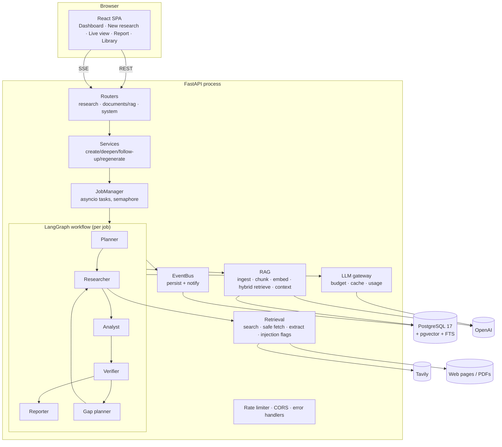
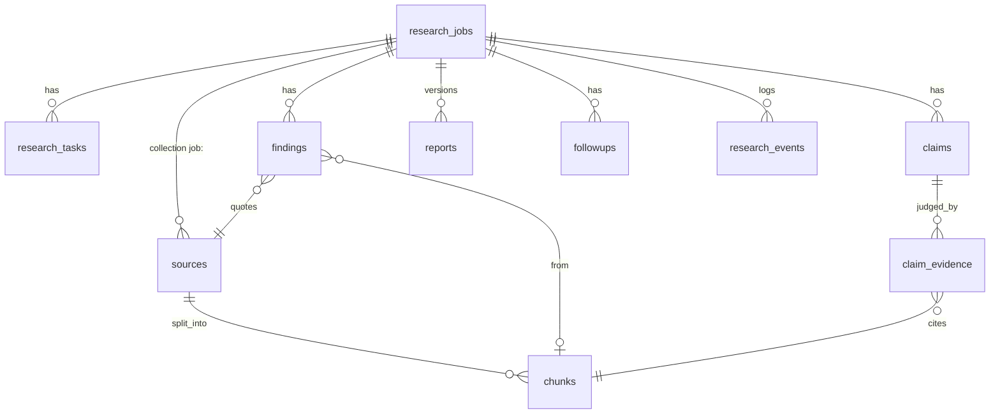

# Architecture

## Overview

## Module layout (`backend/app`)

| Package | Responsibility |
|---|---|
| `core/` | Settings (env), structured logging with secret redaction, errors, rate limiting, text utilities |
| `database/` | Async engine, transactional `session_scope` |
| `models/` | ORM: jobs, tasks, sources, chunks (vector + tsvector), findings, claims, evidence, reports, follow-ups, events, LLM cache |
| `schemas/` | API models and strict LLM structured-output models |
| `llm/` | Provider interfaces, OpenAI + mock providers, embeddings, prompts, gateway, usage/budget tracking |
| `retrieval/` | Search providers, SSRF-safe fetcher, HTML/PDF extraction, prompt-injection heuristics, fixture corpus |
| `rag/` | Chunking, ingestion (dedupe + embedding reuse), hybrid retriever, context assembly, citations, grounded QA |
| `agents/` | Planner, researcher, analyst, verifier, gap planner, reporter |
| `orchestration/` | Depth profiles, job context, event bus, LangGraph graph, job manager |
| `services/` | Use-case functions for the API (create, deepen, follow-up, regenerate, export) |
| `api/` | HTTP routers |
| `evaluation/` | Metrics, baseline systems, CLI runner |

Dependencies point inward: `api → services → orchestration → agents → rag/retrieval/llm → models/core`.

## Key decisions and trade-offs

### 1. The database is the system of record; graph state is control state
LangGraph state holds only `entry`, `iteration`, `halt_reason`, the latest analysis summary, and routing flags.
All evidence (sources, chunks, findings, claims, evidence judgements) is written to Postgres as it is produced.
**Why:** progress survives crashes; the UI and API can inspect a job at any time; resume is "start the graph at
`job.stage`", and every node is idempotent (planner reuses an existing plan, researcher only runs pending tasks,
verifier only verifies pending claims). **Trade-off:** nodes do more DB I/O than a pure in-memory graph.
We did not use a LangGraph checkpointer because the domain tables already contain everything needed to
resume, and keeping one source of truth avoids two diverging copies of state.

### 2. Explicit orchestration over framework magic
LangGraph provides the state machine; routing functions, the bounded loop, budget handling, retries and
cancellation are our own code (`orchestration/graph.py`, `runner.py`, `agents/researcher.py`). LangChain was not
needed: the OpenAI SDK's `chat.completions.parse` gives strict structured outputs directly, and chunking,
retrieval and prompts are small enough to own.

### 3. Background execution without Redis/Celery
Jobs run as asyncio tasks in the API process, bounded by `MAX_CONCURRENT_JOBS`. Progress events are persisted, and
SSE readers poll the DB every 2 s in addition to in-process notification, so streaming would keep working
if events were written by another process. **Why:** the workload is I/O-bound (LLM/HTTP), a single process
handles several concurrent jobs, and this removes two infrastructure components. **When to change:** to run
several API replicas, move job execution to a worker (e.g. arq/Celery on Redis) and replace the in-memory
rate limiter with a Redis one. The JobManager interface (`start/cancel/resume`) is the seam for that.

### 4. Verification decided by rules, not confidence
The model only labels a passage's stance and must quote it. Code checks the quote exists verbatim, checks
numbers, discards ungrounded judgements, and maps the surviving evidence to a status with `decide_status()`.
See [AGENT_WORKFLOW.md](AGENT_WORKFLOW.md#verification).

### 5. Report sections that must be accurate are not written by the model
Methodology (what was actually done), Supporting Evidence (verbatim quotes), Limitations (failed tasks, halts,
unverified claims, flagged sources) and References are generated from the database.

### 6. Mock providers are explicit
Mock LLM/embeddings/search exist for tests and offline demos. They are only active when configured, the app
logs a warning, the UI shows a banner, and reports state it. The fixture corpus is fictional by design.

### 7. Embedding reuse and LLM caching
Chunks are deduplicated by content hash per collection, and identical chunk text is never embedded twice
(embeddings are reused across collections). LLM responses are cached by a hash of model + prompt + schema, so
resuming a failed job or re-running a stage does not repeat paid calls. Regeneration deliberately bypasses the cache.

## Data model

`sources.collection` scopes retrieval: `job:<uuid>` for a research job, `library` for uploads, `eval:*` for evaluation.
