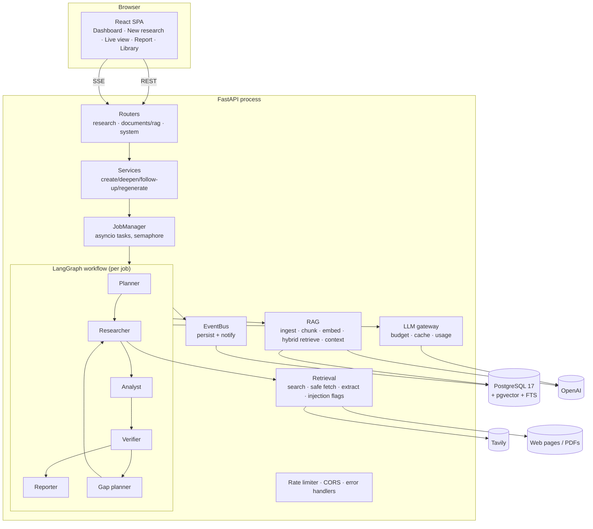
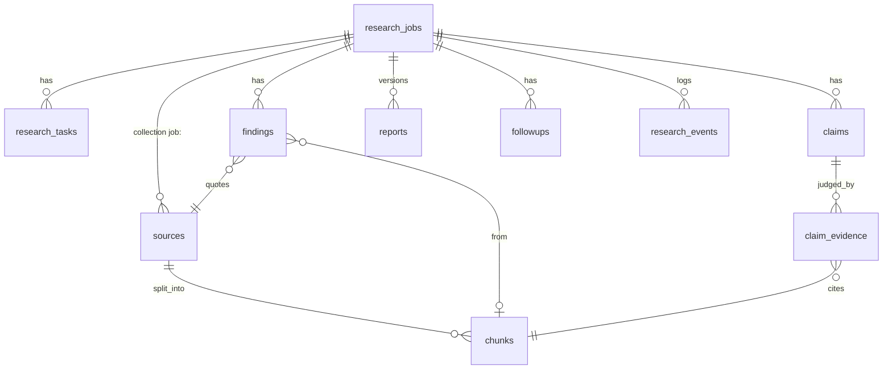

# Architecture

## Overview



## Module layout (`backend/app`)

| Package | Responsibility |
|---|---|
| `core/` | Settings (env), structured logging with secret redaction, errors, rate limiting, text utilities |
| `database/` | Async engine, transactional `session_scope` |
| `models/` | ORM: jobs, tasks, sources, chunks (vector + tsvector), findings, claims, evidence, reports, follow-ups, events, LLM cache |
| `schemas/` | API models and strict LLM structured-output models |
| `llm/` | Provider interfaces, OpenAI + mock providers, embeddings, prompts, gateway, usage/budget tracking |
| `retrieval/` | Search providers, SSRF-safe fetcher, HTML/PDF extraction, prompt-injection heuristics, fixture corpus |
| `rag/` | Chunking, ingestion (dedupe + embedding reuse), hybrid retriever, context assembly, citations, grounded QA |
| `agents/` | Planner, researcher, analyst, verifier, gap planner, reporter |
| `orchestration/` | Depth profiles, job context, event bus, LangGraph graph, job manager |
| `services/` | Use-case functions for the API (create, deepen, follow-up, regenerate, export) |
| `api/` | HTTP routers |
| `evaluation/` | Metrics, baseline systems, CLI runner |

Dependencies point inward: `api → services → orchestration → agents → rag/retrieval/llm → models/core`.

## Key decisions and trade-offs

### 1. The database is the system of record; graph state is control state
LangGraph state holds only `entry`, `iteration`, `halt_reason`, the latest analysis summary, and routing flags.
All evidence (sources, chunks, findings, claims, evidence judgements) is written to Postgres as it is produced.
**Why:** progress survives crashes; the UI and API can inspect a job at any time; resume is "start the graph at
`job.stage`", and every node is idempotent (planner reuses an existing plan, researcher only runs pending tasks,
verifier only verifies pending claims). **Trade-off:** nodes do more DB I/O than a pure in-memory graph.
We did not use a LangGraph checkpointer because the domain tables already contain everything needed to
resume, and keeping one source of truth avoids two diverging copies of state.

### 2. Explicit orchestration over framework magic
LangGraph provides the state machine; routing functions, the bounded loop, budget handling, retries and
cancellation are our own code (`orchestration/graph.py`, `runner.py`, `agents/researcher.py`). LangChain was not
needed: the OpenAI SDK's `chat.completions.parse` gives strict structured outputs directly, and chunking,
retrieval and prompts are small enough to own.

### 3. Background execution: inline, or a Postgres-backed worker queue
Two modes, selected by `JOB_EXECUTION`:

* **`inline`** (default, single process): jobs run as asyncio tasks in the API process, bounded by
  `MAX_CONCURRENT_JOBS`. Zero extra services; right for local use.
* **`worker`** (production): the API only inserts a `queued` row. Any number of `python -m app.worker`
  processes claim jobs with

  ```sql
  UPDATE research_jobs SET status='running', worker_id=:me, heartbeat_at=now(), run_attempts=run_attempts+1
   WHERE id = (SELECT id FROM research_jobs WHERE status='queued' AND NOT cancel_requested
               ORDER BY created_at FOR UPDATE SKIP LOCKED LIMIT 1)
  RETURNING id
  ```

  so each job is claimed by exactly one worker, atomically with its state change. Workers heartbeat their
  jobs every `WORKER_HEARTBEAT_S`; a `running` job whose heartbeat is older than `WORKER_LEASE_S` belongs to a
  dead worker and is **requeued** by any live worker (it resumes from its last completed stage; LLM calls
  already made are served from the response cache, so nothing is paid twice). After `WORKER_MAX_ATTEMPTS`
  lost leases the job fails instead, so a poison job cannot crash-loop the fleet. On SIGTERM a worker stops
  claiming, interrupts its jobs and hands them back to the queue. Cancellation is a DB flag checked between
  every tool/LLM call; workers also hard-cancel after a grace period when they see it on heartbeat.

**Why Postgres and not Redis/Celery:** job state, evidence and progress events already live in Postgres. Using
it as the queue makes claiming a job and changing its state one transaction (no dual-write between a broker
and the DB), adds no infrastructure, and the throughput needed (a handful of long jobs per minute) is far
below what `SKIP LOCKED` handles. Progress reaches the browser because SSE readers poll the events table
(every 2 s, or immediately on in-process notification).

Verified with a crash test: a worker was `SIGKILL`ed mid-job; after the lease expired the job was requeued,
claimed by a second worker on attempt 2, resumed at the interrupted stage and completed
(`tests/integration/test_worker.py` covers the same paths deterministically).

**Still single-instance:** the API rate limiter is in-memory, so with several API replicas each enforces its own
window. The demo quotas (below) are stored in Postgres and are global.

### 4. Verification decided by rules, not confidence
The model only labels a passage's stance and must quote it. Code checks the quote exists verbatim, checks
numbers, discards ungrounded judgements, and maps the surviving evidence to a status with `decide_status()`.
See [AGENT_WORKFLOW.md](AGENT_WORKFLOW.md#verification).

### 5. Report sections that must be accurate are not written by the model
Methodology (what was actually done), Supporting Evidence (verbatim quotes), Limitations (failed tasks, halts,
unverified claims, flagged sources) and References are generated from the database.

### 6. Mock providers are explicit
Mock LLM/embeddings/search exist for tests and offline demos. They are only active when configured, the app
logs a warning, the UI shows a banner, and reports state it. The fixture corpus is fictional by design.

### 7. Observability: OpenTelemetry traces and per-agent cost attribution
Each research job is one trace: `research.job` → `agent.<stage>` → `llm.<task>` / `tool.search` / `tool.fetch` /
`rag.retrieve` → `rag.rerank`. LLM spans use the OpenTelemetry GenAI semantic conventions
(`gen_ai.request.model`, `gen_ai.usage.input_tokens`, `gen_ai.usage.output_tokens`) plus `scout.cost_usd` and
`scout.cache_hit`; prompts and responses are never recorded. Export is opt-in (`OTEL_EXPORTER_OTLP_ENDPOINT`);
`docker compose --profile observability up` starts Jaeger.

Independently of tracing, the `UsageTracker` attributes every token, tool call, dollar and second to the
agent stage that spent it (`usage.by_stage`). The UI shows this per job and across all jobs (`GET /api/usage`),
which answers "where does the money go?" without a tracing backend.

### 8. Two-stage retrieval with an optional cross-encoder reranker
First stage: pgvector HNSW + Postgres FTS fused with RRF (cheap, recall-oriented). Optional second stage
(`RERANKER=cross_encoder`): a local ONNX cross-encoder (`ms-marco-MiniLM-L-6-v2` via fastembed, no PyTorch,
no API cost, baked into the Docker image) re-scores the top `RERANK_CANDIDATES` fused hits. Inference runs in
a thread so it doesn't block the event loop. The evaluation compares every retrieval mode with and without
reranking (see EVALUATION.md); the default is off until a live evaluation shows it helps.

### 9. Public-demo guardrails
Per-job limits (tokens, cost, tool calls, time) already bound a single job. `DEMO_MODE` adds limits across jobs:
a depth cap, a per-visitor daily job quota (visitors identified by a salted hash of their IP; raw IPs are never
stored), and a global daily spend cap. The cap check counts today's recorded spend **plus the remaining budget
reserved by every queued/running job**, so a burst of simultaneous requests cannot overshoot it. Uploads,
"investigate further" and section regeneration can be disabled.

### 10. Embedding reuse and LLM caching
Chunks are deduplicated by content hash per collection, and identical chunk text is never embedded twice
(embeddings are reused across collections). LLM responses are cached by a hash of model + prompt + schema, so
resuming a failed job or re-running a stage does not repeat paid calls. Regeneration deliberately bypasses the cache.

## Data model



`sources.collection` scopes retrieval: `job:<uuid>` for a research job, `library` for uploads, `eval:*` for evaluation.
