# RAG Pipeline

The pipeline lives in `backend/app/rag` and `backend/app/retrieval`. It is used by the research agents, and
independently through `/api/documents`, `/api/rag/search` and `/api/rag/query`.

```mermaid
flowchart LR
  A[Web page / PDF / upload] --> B[Fetch<br/>SSRF-safe, size/type limits]
  B --> C[Extract<br/>trafilatura / pypdf]
  C --> D[Clean<br/>whitespace, de-hyphenate]
  D --> E{Content hash<br/>seen in collection?}
  E -- yes --> X[skip duplicate]
  E -- no --> F[Chunk<br/>token-aware, paragraph-respecting]
  F --> G{Chunk hash embedded<br/>with this model?}
  G -- yes --> H[reuse vector]
  G -- no --> I[Embed in batches]
  H & I --> J[(chunks: text, vector, tsvector, metadata)]
  Q[Query] --> K[Vector search<br/>HNSW cosine]
  Q --> L[Keyword search<br/>Postgres FTS]
  J --> K & L
  K & L --> M[Reciprocal Rank Fusion]
  M --> N[Metadata filters<br/>collection · source · type · domain · flags]
  N --> O[Context assembly<br/>labels, per-source cap, near-dup removal, token budget]
  O --> P[Grounded generation<br/>citations validated]
```



## Stages

| Stage | Implementation | Notes |
|---|---|---|
| Ingestion | `retrieval/fetcher.py`, API upload | URL checks on every redirect hop; 8 MB cap; HTML/PDF/text only. Uploads: extension allow-list, PDF magic bytes, binary check, size cap; parsed in memory, raw file not stored |
| Extraction | `retrieval/extract.py` | trafilatura (precision mode, tables kept) with baseline fallback; title/date metadata; pypdf up to 200 pages; < 200 chars rejected |
| Cleaning | `clean_text` | NUL removal, whitespace normalisation, line-break de-hyphenation, blank-line collapse |
| Chunking | `rag/chunking.py` | `CHUNK_SIZE_TOKENS=450`, `CHUNK_OVERLAP_TOKENS=60` (o200k tokenizer). Packs whole paragraphs; long paragraphs split by sentence, then by tokens. Overlap carries whole trailing units, so chunks never start mid-sentence |
| Dedupe | `rag/ingestion.py` | Document-level: unique `(collection, sha256(text))`. Chunk-level: identical chunk text reuses an existing embedding (any collection, same model) |
| Embedding | `llm/embeddings.py` | `text-embedding-3-small` @1536, batched, retried; usage counted against the job budget |
| Storage | `models/documents.py` | pgvector `vector(1536)` with HNSW (`vector_cosine_ops`); generated `tsvector` with GIN index; per-chunk metadata (title, url, type) |
| Retrieval | `rag/retriever.py` | `hybrid` = top-40 vector + top-40 keyword fused by RRF (k=60). Keyword query ORs terms (`plainto_tsquery` → `|`) and ranks with `ts_rank_cd` |
| Filters | `RetrievalFilters` | collections, source ids, source types, domains, exclude prompt-injection-flagged |
| Context | `rag/context.py` | Greedy packing by rank under a token budget; ≤ 3 chunks/source; drops near-duplicates (> 90 % containment); each passage wrapped in `<untrusted_passage>` with title/domain/date |
| Generation | `rag/qa.py` | Structured `GroundedAnswer` (`insufficient_evidence` flag). Citations not among provided labels are stripped; no citation means insufficient evidence |

## Why hybrid, and what we measured

Dense retrieval handles paraphrase; keyword search handles exact tokens such as figures, product names and
acronyms, which dominate research questions. On the 15-query labelled fixture set with the **offline hashing
embeddings**, hybrid did *not* beat vector (MRR 0.933 vs 0.956; see EVALUATION.md). Those embeddings are themselves
lexical, so that test cannot show the benefit dense retrieval would get from keyword matching. `RETRIEVAL_MODE` is
configurable; re-run `python -m app.evaluation.run retrieval` with real embeddings, on a labelled set from your
domain, before choosing.

## Using it standalone

```bash
curl -F file=@report.pdf localhost:8010/api/documents
curl -XPOST localhost:8010/api/rag/search -H 'content-type: application/json' -d '{"question":"battery prices","k":5,"mode":"hybrid"}'
curl -XPOST localhost:8010/api/rag/query  -H 'content-type: application/json' -d '{"question":"What happened to battery prices?"}'
```
